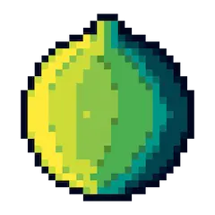
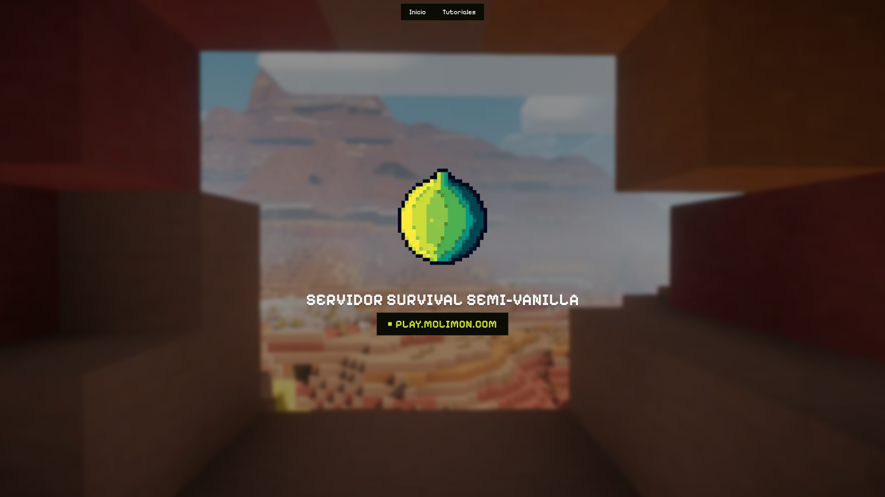

<div align="center">



# MCLimón

**Website for MCLimón, a Spanish-speaking semi-vanilla survival Minecraft server: a landing page with the server IP and in-game tutorials for its plugins.**


[**Live Site**](https://mclimon.com) · [**Report a Bug**](../../issues)

</div>



---

## About the Project

MCLimón was a Minecraft survival server, and new players kept asking the same questions: how to register, how to protect their builds, how the shop works. This site gives them one place to find the server address and step-by-step guides for each plugin, in Spanish.

The tutorials are plain Markdown files edited through [Pages CMS](https://pagescms.org), so non-developers on the staff could update guides without touching code.

**Status:** Archived

## Features

- Landing page with a parallax hero and a one-click button that copies the server IP (`play.mclimon.com`)
- Tutorials section with a collapsible sidebar, ordered by priority
- Guides for registration, PlotSquared plots, land protection, the shop and MineTinker enchantments
- Content editable from a CMS UI, no code changes needed
- Smooth page transitions and prefetching of links as they enter the viewport

## Tech Stack

| Layer               | Technology                          | Why                                                                                      |
| ------------------- | ----------------------------------- | ---------------------------------------------------------------------------------------- |
| Framework           | Astro 7                             | Mostly static content; ships zero JS by default and adds interactivity only where needed |
| Interactive islands | React 19                            | Navbar, sidebar, parallax and copy button hydrate as islands                             |
| Styling             | TailwindCSS 4 + shadcn/ui (Base UI) | Accessible, customizable components with a consistent dark theme                         |
| Animation           | Motion + Astro View Transitions     | Parallax hero and persistent navbar/sidebar across page changes                          |
| State               | Nanostores                          | Shares the sidebar state between separate React islands                                  |
| Content             | Astro Content Collections + Zod     | Type-checked tutorial frontmatter (title, order)                                         |
| CMS                 | Pages CMS                           | Git-based editing of the Markdown tutorials, no backend needed                           |
| Hosting             | Netlify                             | Deployed through the official Astro adapter                                              |
| Tooling             | pnpm, ESLint, Prettier, devenv      | Reproducible dev environment and consistent formatting                                   |

## Architecture

<details>
<summary>Project structure</summary>

```
src/
├── components/
│   ├── layouts/        # Base layout and navbar
│   └── ui/             # shadcn/ui components
├── features/
│   ├── landing/        # Hero, parallax and IP button
│   └── tutorials/
│       ├── components/ # Sidebar and article view
│       ├── content/    # Markdown tutorials (edited via Pages CMS)
│       ├── layouts/
│       └── services/   # Collection queries and sorting
├── pages/              # Routes: / and /tutorials/[...slug]
├── stores/             # Nanostores (sidebar state)
├── styles/             # Global, content and transition styles
└── content.config.ts   # Content collection schema
```

</details>

## Getting Started

### Prerequisites

- Node.js >= 22 and pnpm
- _(Optional)_ [devenv](https://devenv.sh) and [direnv](https://direnv.net)

### Installation

```bash
git clone https://github.com/oscar370/mclimon.git
cd mclimon
pnpm install
pnpm dev
```

**With devenv:**

```bash
direnv allow   # or: devenv shell
pnpm install && pnpm dev
```

### Adding a tutorial

Create a Markdown file in `src/features/tutorials/content/` (or use Pages CMS):

```md
---
title: My Guide
description: Optional short summary.
order: 6 # position in the sidebar
---
```

### Scripts

| Command          | Description                   |
| ---------------- | ----------------------------- |
| `pnpm dev`       | Start the development server  |
| `pnpm build`     | Build for production          |
| `pnpm preview`   | Preview the production build  |
| `pnpm lint`      | Run ESLint                    |
| `pnpm format`    | Format with Prettier          |
| `pnpm typecheck` | Type-check with `astro check` |

## License

Distributed under the GPL-3.0 License. See [`LICENSE`](./LICENSE) for details.
